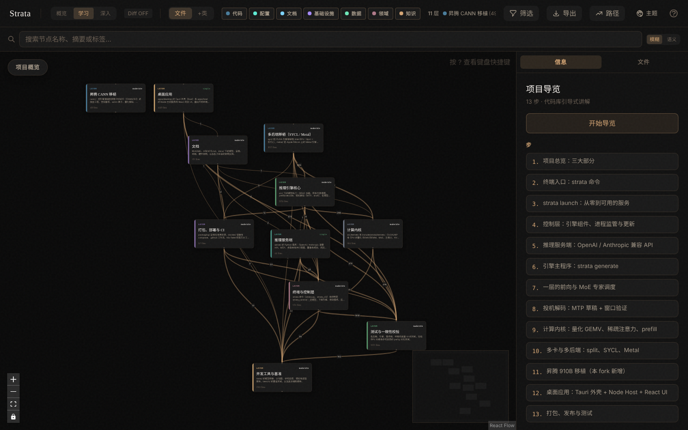
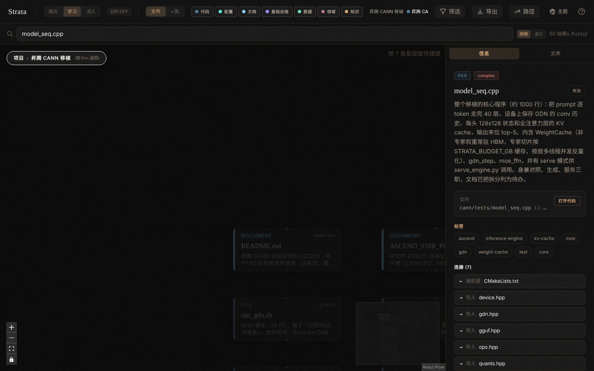

# Strata 代码地图（中文）

> 这是 [Niko1221/Strata](https://github.com/Niko1221/Strata) 的一份代码解读：用 [Understand-Anything](https://github.com/Egonex-AI/Understand-Anything) 生成的知识图谱，加上按阅读顺序整理的说明。对应分支 `main`，提交 `00ad02a7`。

这个分支是 fork 的 `main`：在一个较早的上游版本之上，加了昇腾 910B2C 的 CANN 移植（`cann/` 目录）。上游最新版本的图谱在 `code-map` 分支。

**昇腾移植现状**：昇腾 910B2C 移植已把 Qwen3.6-35B-A3B（qwen35moe）整模型 40 层在 NPU 上跑通：算子、Q4_K/Q5_K/Q6_K/Q8_0 解码（对 ggml 逐位一致）、GDN、注意力加 KV cache、MoE 都有对照测试，verify_all.sh 汇总验收。与 llama.cpp 比较时，同一提示词的 top-5 同序，最大 logprob 差 0.071，贪心续写逐 token 一致。服务方面，`bash cann/tests/start_engine_18790.sh` 在 18790 端口启动本引擎的 OpenAI 兼容端点（预热约 1.8 s/6 token，分词借用 18789 的 llama.cpp），而 18789 实际使用的是 llama.cpp+ggml-cann（约 3.4 tok/s），本引擎约慢 10 倍。还缺：与 `serve/` 的接入、自制批量化 GDN kernel、device 上 top-k、融合 dequant+matmul、异步上传，且不支持逐通道门控（KDA）的 GDN。

Strata 是在自己电脑上运行大模型的开源项目。它的推理引擎是自己写的 C++/CUDA/HIP/SYCL/Metal 代码，不依赖 vLLM、PyTorch 这类框架；模型格式用 GGUF，部分量化块布局和 CPU 专家计算借用了 ggml，测试时拿 llama.cpp 做逐 token 对照。外面包着 Python 兼容 API 服务端、`strata` 终端命令和 Tauri 桌面应用。

## 规模

| 纳入分析的文件 | 节点（含类与函数） | 关系边 | 导入依赖 |
|---:|---:|---:|---:|
| 2,897 | 4,403 | 10,531 | 6,637 |

## 打开交互式图谱

只需要 Node.js 18 以上，不需要 Claude Code 或 API key：

```sh
git clone -b main https://github.com/tyloryang/strata
npx https://github.com/Egonex-AI/Understand-Anything/releases/latest/download/understand-anything-viewer.tgz ./strata
```

终端会打印一个带 token 的本地地址并打开浏览器。仪表盘可以按层浏览、搜索文件、点开任意节点看中文摘要、依赖和源码，右侧「项目导览」就是下面的 13 步阅读顺序。



## 一次请求怎么走到 GPU

- **入口 · 桌面应用 或 strata 命令**（`apps/desktop` · `apps/host` · `strata.py` · `strata_cli/`）：用户在桌面应用里点选，或在终端运行 `strata launch`，两者最后都交给同一个控制层。
- **控制 · strata_control**（`engine_component.py` · `runtime.py` · `updater.py`）：校验本地引擎包的哈希与签名，按保存的 profile 启动并监管服务进程，处理签名更新。
- **服务 · Python 推理服务端**（`serve/server.py` · `serve/frontend.py`）：对外提供 OpenAI / Anthropic 兼容 API 和网页；渲染聊天模板，只把 token id 经 stdin/stdout 交给引擎进程。
- **引擎 · C++ 引擎主程序**（`src/program/generate.cpp` · `src/dsv41/ds4_main.cpp`）：把 embedding、逐层前向、MoE 专家调度、投机解码和采样串成生成循环；放不进显存的专家从 SSD 读取。
- **内核 · 计算内核**（`src/kernels` · `src/prefill` · `include/strata/kernels`）：量化 GEMV/GEMM、MoE、QSA 稀疏注意力、KV cache 量化，CUDA 与 HIP 共用一套源码。
- **后端 · 多卡与其他硬件**（`src/split` · `sycl/` · `metal/`）：split 把每层切到 2–8 张卡；SYCL 版面向 Intel Arc，Metal 版面向 Apple Silicon。
- **昇腾 · CANN 移植（本 fork 新增）**（`cann/src` · `cann/tests/model_seq.cpp` · `cann/tests/serve_engine.py`）：独立于 src/ 的昇腾 910B2C 引擎，用 aclnn 算子跑通 Qwen3.6-35B-A3B 整模型，18790 端口提供 OpenAI 兼容接口；尚未接入 serve/。

## 11 个架构分层

| 分层 | 文件数 | 包含什么 |
|---|---:|---|
| 测试与一致性校验 | 1,021 | 各后端、引擎、服务端、终端和桌面 UI 的测试，包括 GPU 内核与参考实现的 parity 对比测试。 |
| 桌面应用 | 459 | apps/desktop 的 Tauri 外壳（Rust）与 apps/host 的 Node 主机服务和 React 网页 UI，面向不用终端的普通用户。 |
| 推理引擎核心 | 325 | src/ 下的模型执行：GGUF 加载、层与专家调度、prefill/decode、投机解码（MTP、draft）、各模型族实现（DeepSeek V4.1、Qwen3.5/3.6、split 引擎），以及公共头文件与 CMake 构建。 |
| 多后端移植（SYCL / Metal） | 302 | sycl/ 把 CUDA 引擎移植到 Intel GPU（dpct + SYCL），metal/ 是 Apple Silicon 上的 Metal 引擎与转换工具。 |
| 开发工具与基准 | 230 | tools/ 的模型转换、分词器、参考实现、调优与实验脚本，bench/ 的基准测试，以及其余辅助脚本。 |
| 计算内核 | 164 | src/kernels 与 include/strata/kernels：CUDA/HIP 与 CPU 的量化 GEMV/GEMM、MoE、注意力、KV cache 量化等底层算子。 |
| 终端与控制层 | 124 | strata 命令（strata.py、strata_cli/）与控制层 strata_control/：选模型、下载引擎、启动服务、监控、更新；以及源码安装入口 setup.py / setup.sh / *.bat。 |
| 文档 | 121 | README、AGENTS.md、docs/ 下的模型、安装、终端、硬件说明，以及各子目录的说明文档。 |
| 打包、部署与 CI | 57 | packaging/ 安装包与更新源、docker/ 镜像与 compose、.github 工作流、Nix flake 和第三方工具集成。 |
| 昇腾 CANN 移植 | 49 | cann/：把引擎移植到昇腾 910B2C（CANN 9.0）的独立工程，含设备层、aclnn 算子、量化解码、GGUF、GDN、注意力与 MoE，逐层对照测试和 18790 端口的 OpenAI 兼容服务。本 fork 新增。 |
| 推理服务端 | 45 | serve/ 的 Python 服务：OpenAI / Anthropic 兼容 API、MCP、多副本与并行调度、图像与视觉、网页聊天界面；以及 Intel 版服务入口。 |

## 13 步阅读导览

### 1. 项目总览：三大部分

Strata 让大模型在自己电脑上本地运行。AGENTS.md 把它分成三部分：桌面应用（apps/）、终端工具 strata 命令（strata.py、strata_cli、strata_control），以及引擎与服务端（src/include/metal/sycl 的 C++/CUDA/HIP/SYCL/Metal 引擎 + serve/ 的 Python 服务）。先读 README 和 AGENTS.md 建立整体印象，后面每一步都沿着一次请求从用户到 GPU 的路径往下走。

关键文件：`README.md`、`AGENTS.md`、`docs/DETAILS.md`

### 2. 终端入口：strata 命令

strata.py 是极简入口：先把控制权交给 strata update 装好的新版 Control，再做依赖预检，最后转交 strata_cli/cli.py。cli.py 用 argparse 声明 serve、launch、models、runtime、tune、bench 等子命令，并把实际工作分派给 strata_control。

关键文件：`strata.py`、`strata_cli/cli.py`、`strata_cli/__init__.py`

### 3. strata launch：从零到可用的服务

launch 是给用户和 agent 的主路径。catalog/settings 决定模型族与量化包，runner.py 用统一的事件流依次完成：从签名 feed 获取引擎、调 setup.py 的安装模式下载模型、写 profile、自动调优、经 runtime 后台启动并开放访问。TUI 和 --no-tui 共用同一事件流。

关键文件：`strata_cli/launch/runner.py`、`strata_cli/launch/catalog.py`、`strata_cli/launch/settings.py`、`setup.py`

### 4. 控制层：引擎组件、进程监管与更新

strata_control 是终端与桌面应用共享的控制逻辑。engine_component.py 只在本地组件目录里查找并校验引擎包（哈希+签名，不下载）；runtime.py 是进程 supervisor，POSIX 用 AF_UNIX 套接字与 flock 租约，Windows 用回环 TCP 与 job object；updater.py 负责签名更新。

关键文件：`strata_control/engine_component.py`、`strata_control/runtime.py`、`strata_control/updater.py`、`strata_control/profiles.py`

### 5. 推理服务端：OpenAI / Anthropic 兼容 API

serve/server.py（约 1 万行）用标准库 ThreadingHTTPServer 提供 Chat Completions、Anthropic Messages、Responses、图像、健康检查与网页。StrataEngine 通过 stdin/stdout 驱动常驻的 C++ 引擎进程，只传 token id、收文本增量；Service 串行调度请求并管理会话与 KV cache。frontend.py 负责聊天模板渲染和流式输出中 <think>/<tool_call> 的增量解析。

关键文件：`serve/server.py`、`serve/frontend.py`、`serve/responses.py`、`serve/mcp.py`、`serve/replicas.py`

### 6. 引擎主程序：strata generate

src/program/generate.cpp（2 万多行）是 C++ 侧最核心的程序：把 embedding、各层捕获的 CUDA/HIP graph、CPU 专家池、lm_head 与采样串成端到端生成，并承载服务会话、投机解码、对话缓存与多卡调度。DeepSeek V4.1 有独立入口 ds4_main.cpp，用同样的 stdin/stdout 协议（INFO/READY/GEN/T/DONE）对接 server.py。

关键文件：`src/program/generate.cpp`、`src/dsv41/ds4_main.cpp`、`src/qwen35/q36_engine.cu`、`CMakeLists.txt`

### 7. 一层的前向与 MoE 专家调度

layer.cpp 按固定顺序把 RMS norm、量化 GEMV、门控 delta 递推（GDN）、注意力和 MoE 合并组成一层。expert_source.cpp 是专家池与 session 循环的适配层，把 top-k 专家 id 和路由权重交给 CPU 池或 GPU 窗口；它还负责内存规划：cgroup 可用内存、pin、NUMA 放置，以及 O_DIRECT 与 page cache 两种读法的测速——这正是放不进显存的部分能从 SSD 读取的原因。

关键文件：`src/core/layer.cpp`、`src/core/expert_source.cpp`、`src/platform/direct_file.cpp`、`src/platform/memory.cpp`

### 8. 投机解码：MTP 草稿 + 窗口验证

mtp.cpp 的 MtpDrafter 用多 token 预测层产出草稿 token；verify.cpp 把一个窗口的多个 token 一次跑过整个模型来校验并提交。src/spec 提供 draft_policy（窗口大小策略）和 suffix_drafter（n-gram 草稿），两者共同决定每步能多出几个 token。

关键文件：`src/core/mtp.cpp`、`src/core/verify.cpp`、`src/spec/draft_policy.cpp`、`src/spec/suffix_drafter.cpp`

### 9. 计算内核：量化 GEMV、稀疏注意力、prefill

src/kernels 和 include/strata/kernels 是底层算子：MMVQ 与 i-quant 反量化 GEMV、MoE 专家 GEMV、QSA 稀疏注意力（qsa_select.cu 对块打分并做 top-k）、KV cache 量化等。src/prefill 是 prompt 预填充专用的 WMMA/MMQ GEMM 与分块 GDN。CUDA 与 HIP 共用这一套源码。

关键文件：`src/kernels/cuda/qsa_select.cu`、`include/strata/kernels/native_mmvq.hpp`、`include/strata/kernels/iq_kernels.hpp`、`include/strata/kernels/kv_q4.hpp`、`src/prefill/moe_ws.cuh`

### 10. 多卡与多后端：split、SYCL、Metal

src/split 是每层切分到 2–8 张卡的 sFNX 引擎，卡间用 ring 求和。sycl/ 用 SYCLomatic（dpct）把 CUDA 引擎迁移到 Intel Arc，并有 server_intel.py 包装服务；metal/ 是 Apple Silicon 引擎，metal_compat 提供 CUDA 兼容头，MSL kernel 运行时编译。

关键文件：`src/split/src/engine.hpp`、`sycl/src/program/generate.cpp`、`sycl/serve/server_intel.py`、`metal/include/strata/gpu/runtime.hpp`、`metal/kernels/moe_mm.metal`

### 11. 昇腾 910B 移植（本 fork 新增）

cann/ 是与 CUDA 的 src/ 并行的独立工程，不依赖主引擎代码。device.cpp 封装 ACL 运行时并用分桶内存池避免频繁 aclrtMalloc；ops.cpp 用 aclnn 两阶段调用实现 fp16 算子；quants/gguf/tensor_load 负责量化解码与读模型。tests/model_seq.cpp 把 Qwen3.6-35B-A3B 整模型 40 层跑在 NPU 上，与 llama.cpp 对比 top-5 同序、最大 logprob 差 0.071、贪心续写逐 token 一致；serve_engine.py 在 18790 端口提供 OpenAI 兼容接口。尚未接入 serve/，速度约为 llama.cpp+ggml-cann 的十分之一。

关键文件：`cann/README.md`、`cann/src/device.cpp`、`cann/src/ops.cpp`、`cann/tests/model_seq.cpp`、`cann/tests/serve_engine.py`

### 12. 桌面应用：Tauri 外壳 + Node Host + React UI

main.rs 只做外壳：在空闲端口启动随包的 Node App Host，开同源 webview，退出时经 Control 关停引擎。apps/host/server 是本地 API 与控制平面（native-control.mjs），agent-bridge.mjs 把聊天映射为 DeepSeek Harness 会话；apps/host/src 是 React 界面（App、Chat、ModelRun 等屏幕）。

关键文件：`apps/desktop/src-tauri/src/main.rs`、`apps/host/server/native-control.mjs`、`apps/host/server/agent/agent-bridge.mjs`、`apps/host/src/app/App.tsx`、`apps/host/src/screens/Chat.tsx`

### 13. 打包、发布与测试

packaging/feed_tool.py 在离线机器上用 Ed25519 给引擎包签名并生成更新 feed，用户端由 strata update 验证；package_terminal.py 打终端包，docker/ 提供 NVIDIA/AMD/Intel 镜像。测试分布在 tests/（终端、core、各后端 parity）、apps/host/tests 与 serve/test_*，GPU 内核普遍用与参考实现逐项对比的 parity 测试把关。

关键文件：`packaging/feed_tool.py`、`packaging/package_terminal.py`、`Dockerfile`、`docker/entrypoint.sh`、`tests/terminal/launch_support.py`

## 被依赖最多的文件

按项目内导入次数排序，不含测试和只有一行的包初始化文件。改动这些文件影响面最大。

| 文件 | 被导入 | 说明 |
|---|---:|---|
| `sycl/include/dpct/dpct.hpp` | 158 | Intel SYCLomatic（dpct）运行时辅助库的总入口头文件：说明 DPCT_USM_LEVEL_NONE、DPCT_PROFILING_ENABLED、DPCT_HELPER_VERBOSE 三个宏，并 include atomic、device、image、kern… |
| `apps/host/src/lib/i18n.ts` | 127 | 前端国际化核心：导入 en.json 以及 tune/tools 等多批 zh/ja/de/es/ru/pt/ko/fr 语言包，合并成各语言字典；导出 LANGUAGES、validLanguage、currentLanguage、localeTag 与 setTranslat… |
| `serve/server.py` | 122 | Python 推理服务端的核心（约 1 万行）：用标准库 ThreadingHTTPServer 提供 OpenAI Chat Completions、Anthropic Messages、Responses、图像生成、/v1/models、/health、/metrics、/c… |
| `setup.py` | 99 | 源码检出的一键安装器，约 1.1 万行：检测 NVIDIA/AMD/Mac 硬件，询问模型族、量化大小、上下文与视觉，创建 .venv 并安装依赖，获取预编译或本地编译的引擎，从 Hugging Face 断点下载模型，写入 run-<model>.bat/.sh 并启动服务。同… |
| `apps/host/src/components/ui.tsx` | 97 | Strata 的 UI 原语库：封装设计套件的 st-* 样式类，提供 Btn、IconBtn、Icon、Dialog、Select、ErrorNotice、ActionError、Toasts 等，含焦点管理、portal、ARIA 属性与 toast 的暂停/关闭，并联动 s… |
| `serve/frontend.py` | 79 | 请求/响应文本层（不涉及模型和 GPU）：把 OpenAI 与 Anthropic 请求规范化为聊天模板消息，用 Jinja 渲染模型自带的 chat template（与 chat_golden.json 对照校验），并包含 OutputParser，增量解析流式输出中的 <t… |
| `sycl/include/strata/sycl_queue.hpp` | 74 | SYCL 移植对引擎 API 面唯一的新增：q_of() 把 CUDA 的 void* stream（null 表示默认流）转成 sycl::queue*，null 时返回默认 in-order 队列；big_fill_zero 把超大设备清零拆成不超过 256 MiB 的计算 … |
| `strata_control/engine_component.py` | 63 | 在本地组件目录中查找并校验本机适用引擎包，没有任何下载路径：定义 engine-component.json 清单（schema 2）、EngineComponent、EngineMissing/EngineIntegrityError（退出码 5），解析 components_… |
| `include/strata/kernels/qsa.hpp` | 63 | QSA（全注意力）层的缓存、indexer 与注意力 kernel 的公共接口（P2.S2）：kv_append 写分页 KV、indexer_key_append 与块池化、qsa_index 按 cell 的 indexer 打分、topk_512 选择等。规格以 ref/q… |
| `apps/host/src/lib/store.ts` | 60 | 前端的全局状态仓库（约 2400 行、上百个导出）：自带订阅机制和 useStore selector，管理会话/聊天消息与流式帧、模型连接、主题/语言/字号/密度/动效/透明度等外观设置、toast 与错误、Agent 询问与审批、loop 调度、排队消息、生命周期状态与启动引… |

## 文件说明在哪里

- `.ua/knowledge-graph.json`：完整图谱，每个文件一个节点，`summary` 字段是中文说明，`edges` 是导入、包含、测试、文档、配置等关系。
- `docs/understand/strata-map.html`：单页版代码地图，下载后用浏览器打开。
- 节点详情示例：



## 生成方式与局限

- 按 Understand-Anything 的 `/understand` 流程和图谱格式生成，输出语言为中文。
- 生成环境装不上 tree-sitter，所以扫描和依赖解析用 Python 实现：Python 用 `ast`，C/C++/CUDA/Metal 解析 `#include`，TS/JS 解析 `import`，Markdown 解析链接。C++ 只提取了类/结构体和 GPU kernel，没有函数级调用关系。
- 254 个核心文件和各模块的说明由分析代理阅读源码后撰写，大文件只读了开头和函数清单；其余文件的说明根据文件头注释和结构自动生成。
- 排除了基准结果数据、多语言 README、图片、第三方代码、测试夹具等非代码内容。
- 图谱对应上面写明的提交；之后源码有变动时，图谱不会自动更新。
- `cann/` 的说明依据 `cann/README.md`、`cann/ASCEND_910B_PORT_STATUS.md` 和源码撰写，性能与对齐数字都来自这两份文档的记录，没有重新测量。
